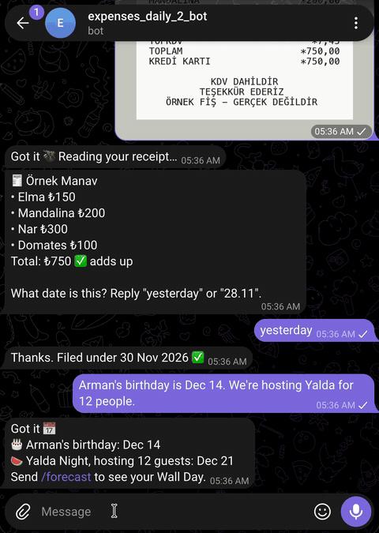

# Ledgerly 🦥

A Telegram bot for people who are too lazy to track their spending.

Send it a photo of a receipt. **Gemma** reads it, and plain code checks that the items add
up before anything is filed. Tell it about family events in plain chat: "Arman's birthday is
Dec 14." **TabPFN** reads the ledger and the calendar and tells you **Wall Day**: the day the
budget runs out, while you can still change it.

[](https://render.com/deploy?repo=https://github.com/asi-mir/ledgerly)



*The demo copy on Dec 1, sped up. A made-up household: every amount is made up.*

## Your own copy in 3 steps

Each person runs their own bot and their own database. One bot = one household.

1. **Get three keys and your Telegram ID.**
   - A Telegram bot token from [@BotFather](https://t.me/BotFather) (`/newbot`).
   - Your numeric Telegram ID from [@userinfobot](https://t.me/userinfobot).
   - A Gemini API key from [Google AI Studio](https://aistudio.google.com/apikey) (it serves Gemma).
   - A TabPFN token from [Prior Labs](https://ux.priorlabs.ai) (account, API keys).
2. **Click "Deploy to Render"** above and paste them: `TELEGRAM_BOT_TOKEN`,
   `ALLOWED_TELEGRAM_IDS`, `GEMINI_API_KEY`, `TABPFN_TOKEN`. `SENTRY_DSN` is optional (leave it
   empty to turn tracing off). Render creates a free web service and a free Postgres database
   from [`render.yaml`](render.yaml), and makes a random webhook secret for you.
3. **Open your bot in Telegram and send `/start`.** Answer two questions: your monthly budget
   and your payday. A plain number means dollars. Another currency? Write the budget with its
   sign, like `₺30,000` or `3000 EUR`, and the bot uses that currency from then on. Then send a
   receipt photo.

The bot sets its own Telegram webhook when it starts. It answers only the IDs in
`ALLOWED_TELEGRAM_IDS`.

## What it does

| You send | The bot |
|---|---|
| A receipt photo | Reads the shop, date, items and total. Files it only if the items add up: "✅ adds up". If not, it keeps it aside as "⚠️ needs check" (not counted) and tells you the difference. |
| A photo without a readable date | Asks "What date is this?". You answer "yesterday" or "28.11". It never guesses a date. |
| The same photo twice | "You already sent me this one 🦥" |
| "Arman's birthday is Dec 14. We're hosting Yalda for 12 people." | Saves both events and confirms them. |
| `/forecast` | Likely spending for the rest of the pay period (low, likely, high), your budget, 🧱 Wall Day, and the biggest reason. |
| "Can I afford a ₺5,000 gift for Arman?" | Runs the forecast again with that money on Arman's birthday and says how Wall Day moves. |
| `/start` | Asks for budget and payday again. The currency comes from the budget answer. |

Persian holidays (Yalda, Chaharshanbe Suri, Nowruz, Sizdah Bedar) are built in for 2025 to 2027.

## How each piece is used

| Tool | Its one job |
|---|---|
| **Gemma 4** (Google AI Studio, or Ollama on your laptop) | Reads every receipt photo into rows, and turns every chat message into a small JSON command (add an event, run the forecast, can I afford it). It never does the math and never predicts money. |
| **Plain Python** | Checks that the items add up to the total. Stores money as integer cents. |
| **TabPFN** (Prior Labs API) | Learns from a tiny daily table (one row per day, no training run) and predicts each remaining day of the pay period with low, likely and high values. This is where Wall Day and "can I afford it?" come from. |
| **Render** | Runs the bot (free web service) and its database (free Postgres) from one `render.yaml`. The Deploy button gives anyone their own copy. |
| **Sentry** (optional) | One trace per Telegram message: the Gemma call (model, seconds, tokens), the tool call and the TabPFN step. No prompts, no images, no replies and no request headers are sent. |

The receipt rules Gemma follows are a plain Markdown file:
[`prompts/receipt_rules.md`](prompts/receipt_rules.md). Change it for German, Iranian or
Spanish receipts. The chat rules are in [`prompts/chat_agent.md`](prompts/chat_agent.md).

## Privacy

- Images are never stored. The database keeps Telegram's file ID; Telegram keeps the photo.
- The free AI Studio tier may use your data to improve Google's products. For full privacy, run
  Gemma yourself: set `GEMMA_PROVIDER=ollama` (default model `gemma4:e4b`), and receipts stay on
  your machine.
- Sentry gets timings and token counts only (`send_default_pii=False`; request headers, reply texts and the bot token are removed before sending).

## Numbers and how to get them

Test and backtest numbers come from a command in this repo. Timings come from Sentry traces
and Render logs of my own copy (`render` environment, free plan, Frankfurt).

| What | Number |
|---|---|
| Tests | 165 offline tests, plus 5 live checks with real Gemma and TabPFN |
| TabPFN error on the 14-day total, real ledger | **19.3%** (two windows: 1.3% and 37.2%) |
| Same for "a typical day" (median day × 14) | 24.5% |
| Same for "an average day" (mean day × 14) | 250.9% (a few very large days pull the mean up) |
| Days inside TabPFN's low-to-high range (0.1 to 0.9) | 92.9% |
| Daily error (WAPE): TabPFN / typical day / average day | 73.5% / 68.6% / 263.5% |

The backtest hides the last two non-overlapping 14-day stretches of a real ledger (63 days,
my own, not published) and forecasts each one from the days before it, with the same code as
the bot. Day by day, a typical day is slightly better than TabPFN; on the 14-day total, which
is what Wall Day needs, TabPFN is better. Two windows is a small test.

```bash
.venv/bin/pytest -q                                   # the test suite
LEDGER_CSV=path/to/your/ledger.csv .venv/bin/python scripts/backtest.py   # TabPFN vs a typical and an average day
LEDGERLY_LIVE=1 .venv/bin/pytest -q -m live           # real Gemma + TabPFN checks (needs keys in .env)
```

| Timing (my copy on Render) | Number |
|---|---|
| "Can I afford a ₺5,000 gift?" (one Sentry trace) | 2.11 s in total; Gemma 1.59 s, 1,149 input + 37 output tokens; forecast tool 0.07 s (ready in the background) |
| TabPFN step on Render (365 past days, 31 days ahead) | 34.0 s on the first `/forecast`, before libraries loaded at boot; about 3 s after (2.95 to 3.43 s) |
| First answer after a nap (23 quiet minutes) | 43 s ("Sorry for the wait"); the forecast after 77 s, because the first TabPFN step after a wake-up took 29 s |
| Blueprint check, then first create call to a live service through Render's API | `valid: true`; about 4 minutes (4 min 14 s) |

## Run it locally

```bash
python3.12 -m venv .venv && .venv/bin/pip install -r requirements.txt
cp .env.example .env    # fill in the keys
.venv/bin/pytest -q
.venv/bin/uvicorn app.main:app --reload   # http://localhost:8000/health
```

Locally the bot uses SQLite (`data/private/ledger.db`). Tests post made-up Telegram updates to
the app; there is no polling mode.

**Demo copy.** Set `DEMO_TODAY=2026-12-01` (and `CURRENCY=₺`) to pin the bot's date and seed a synthetic household
(a made-up family, 12 months of made-up receipts, `samples/`). All amounts in the demo data and
in this README are made up.

## Good to know

- Render's free web service sleeps after 15 quiet minutes. After a nap, the first answer takes
  about a minute. Your message is not lost: Telegram sends it again, and the bot says sorry for
  the wait. The webhook answers Telegram at once and works in the background, and repeated
  updates are skipped.
- Render's free Postgres expires 30 days after it is created.
- Leave out `plan: free` in `render.yaml` and Render picks a paid plan. It is set on both
  resources.
- Not in Turkey? The currency comes from your budget answer (see step 3). The bot's clock uses
  `Europe/Istanbul`: in Render, open your service → **Environment** → `TIMEZONE` and set yours
  (for example `Europe/Berlin` or `America/New_York`). The receipt rules in
  `prompts/receipt_rules.md` are written for Turkish receipts; adapt them to yours. The built-in
  holidays are Persian ones.

## Layout

```
app/        main.py (webhook), receipts.py, agent.py, onboarding.py, forecast.py, holidays.py,
            db.py, demo.py, tracing.py, providers/{aistudio,ollama}.py
prompts/    receipt_rules.md, chat_agent.md
scripts/    backtest.py, make_demo_data.py, make_sample_receipts.py
samples/    synthetic demo data and receipt images
tests/
```

## Commits after 2026-10-26 09:59 (+03)

None.

## License

MIT
